## Context

Zach Lloyd's talk "How to Build a Software Factory That Improves Itself" (AI Engineer,
https://youtu.be/nKjPBAw_N_0) shows Warp's own factory from the inside. Our review of it is
miadi-review:d47ef197-8fc2-4f81-be25-67d4e335d104 (v8, https://miadi-review-service.vercel.app/review/d47ef197-8fc2-4f81-be25-67d4e335d104).
On 2026-11-19 Guillaume attached fourteen screenshots of it, some annotated, and asked for the root
work that brings what it shows into the Miadi Factory at every level: plugins, the factory's
packages, the wheel, and an episode. No issue cites the review and no episode holds it.

### What the screenshots show

Warp closes a loop: every run is scored, failures are grouped, an agent investigates them, and a
pull request changes the factory's own definitions once a person approves it.

| | what it shows | the capability, the interface, the person's experience |
|---|---|---|
| <a href="https://github.com/jgwill/miadi-orchestration-kit/blob/main/rispecs/self-improvement-cycle/screenshots/13-runs-list.jpg">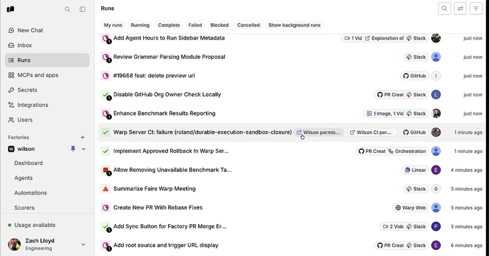</a> | 13 · Runs (09:04): each run's state, its source (Slack, GitHub, Linear, Warp Web), what it made, who asked | every agent session is one run a person can find |
| <a href="https://github.com/jgwill/miadi-orchestration-kit/blob/main/rispecs/self-improvement-cycle/screenshots/07-scorer-redundant-tests-per-run.jpg">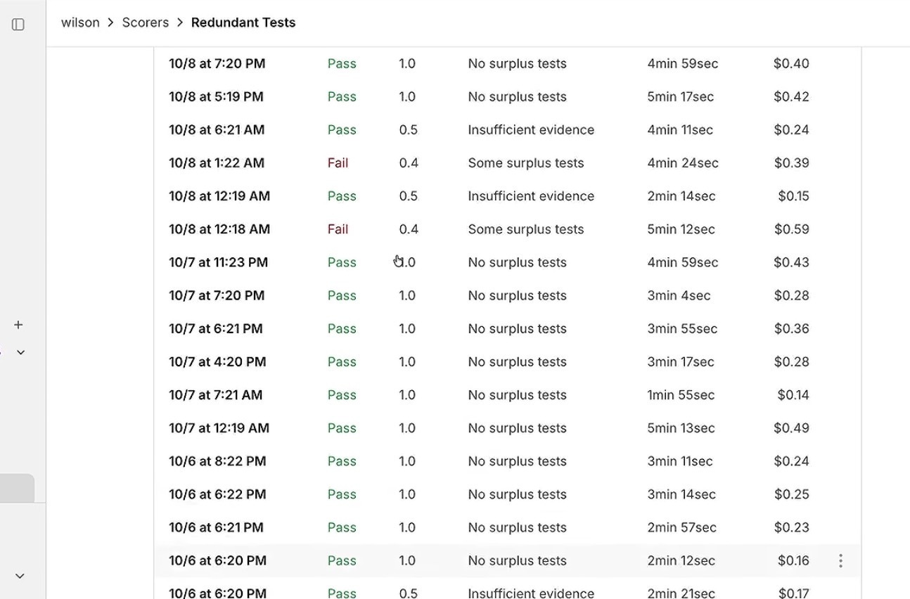</a> | 07 · Scorer "Redundant Tests": pass or fail per run, a score, the verdict in words, cost | an LLM judge over each run's trace (11:52) |
| <a href="https://github.com/jgwill/miadi-orchestration-kit/blob/main/rispecs/self-improvement-cycle/screenshots/08-dashboard-scorers.jpg">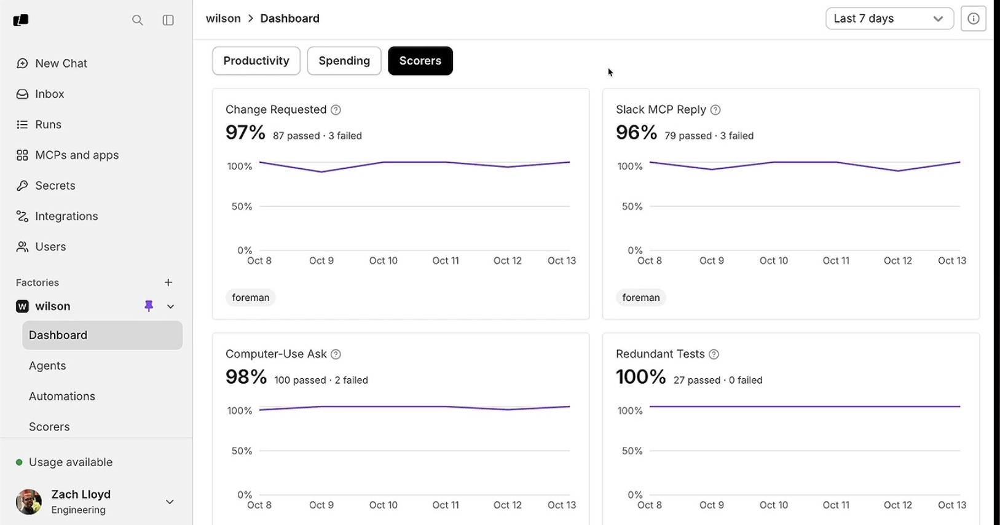</a> | 08 · Dashboard, Scorers: pass rate per day for each scorer, tagged with the agent it scores | the factory's quality, read at a glance |
| <a href="https://github.com/jgwill/miadi-orchestration-kit/blob/main/rispecs/self-improvement-cycle/screenshots/04-inbox-item-failed-runs-and-run.jpg">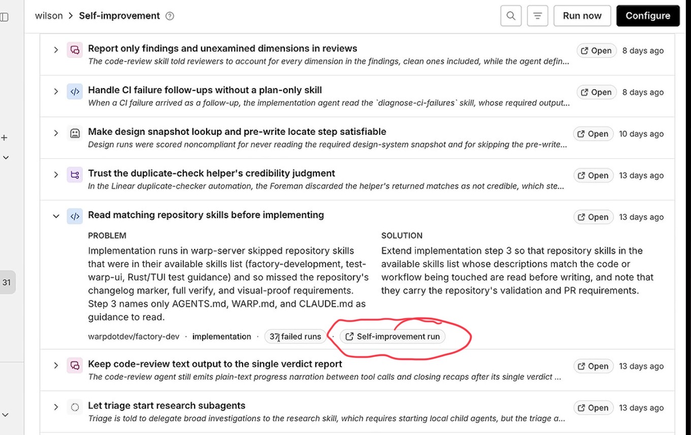</a> | 04 · "37 failed runs" grouped into one item, linked to its "Self-improvement run" (circled by Guillaume) | failures become one item with its count |
| <a href="https://github.com/jgwill/miadi-orchestration-kit/blob/main/rispecs/self-improvement-cycle/screenshots/05-self-improvement-run-foreman-verdicts.jpg">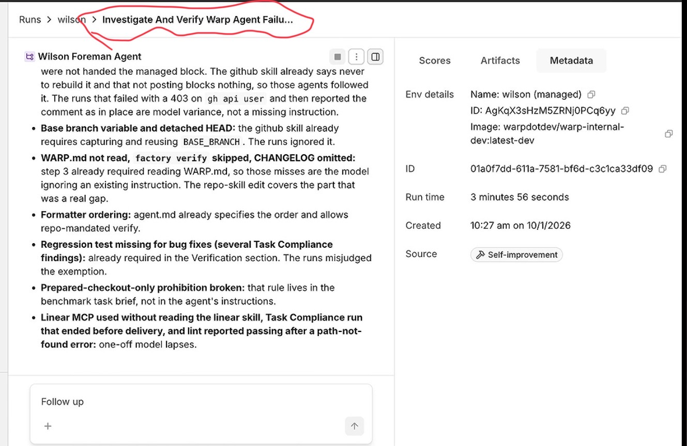</a> | 05 · The Foreman's investigation: a verdict per kind of failure (an instruction that exists and was ignored, model variance, a misjudged exemption, a rule kept in a brief rather than in the agent's instructions, one-off lapses) | what is really missing from the definitions becomes a change (our reading) |
| <a href="https://github.com/jgwill/miadi-orchestration-kit/blob/main/rispecs/self-improvement-cycle/screenshots/03-self-improvement-inbox-item-open-a-pr.jpg">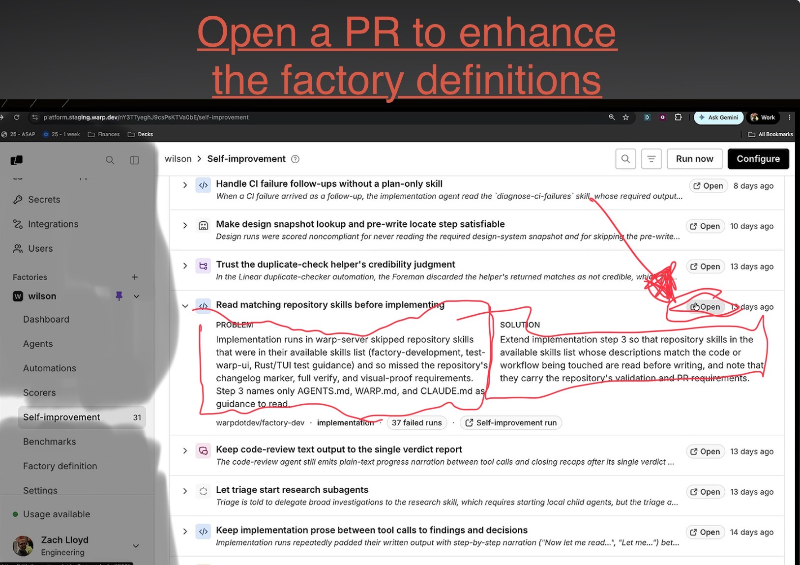</a> | 03 · Self-improvement inbox (12:53 to 13:49), the expanded item showing Problem and Solution, repository, agent, count, Open. Guillaume: "Open a PR to enhance the factory definitions" | the person reads each proposal in two columns |
| <a href="https://github.com/jgwill/miadi-orchestration-kit/blob/main/rispecs/self-improvement-cycle/screenshots/01-pr-1061-read-matching-repository-skills.jpg">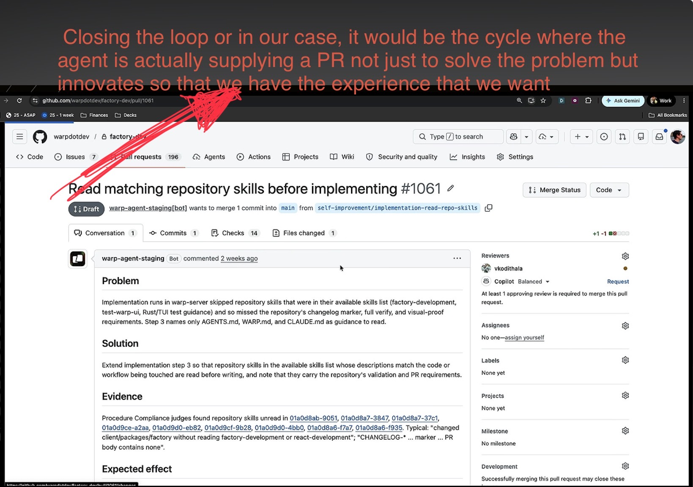</a> | 01 · The draft PR a bot opened: Problem, Solution, Evidence (the judged run ids), Expected effect | a change to the factory comes with its evidence |
| <a href="https://github.com/jgwill/miadi-orchestration-kit/blob/main/rispecs/self-improvement-cycle/screenshots/14-pr-1061-diff.jpg">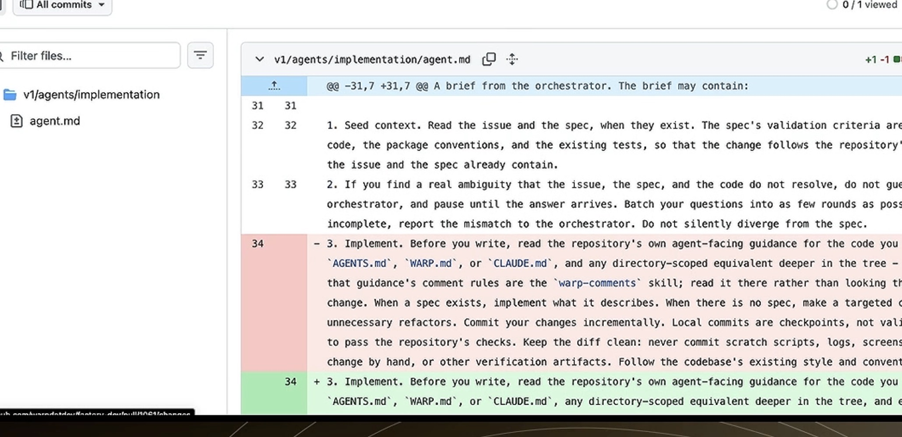</a> | 14 · Its diff: one line of `v1/agents/implementation/agent.md` (13:49) | the change is small and reviewable |
| <a href="https://github.com/jgwill/miadi-orchestration-kit/blob/main/rispecs/self-improvement-cycle/screenshots/06-self-improvement-approval-rate.jpg">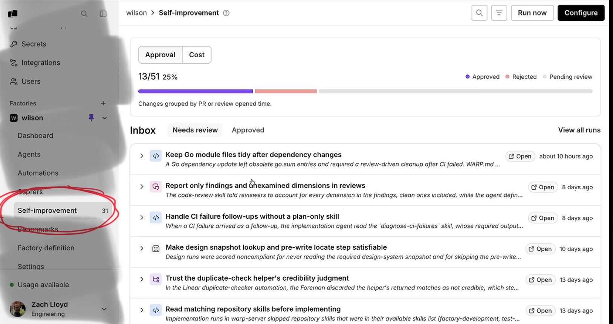</a> | 06 · Approval 13 of 51, 25%: approved, rejected, pending | the person rules, and the rate is visible |
| <a href="https://github.com/jgwill/miadi-orchestration-kit/blob/main/rispecs/self-improvement-cycle/screenshots/09-agents-foreman-and-subagents.jpg">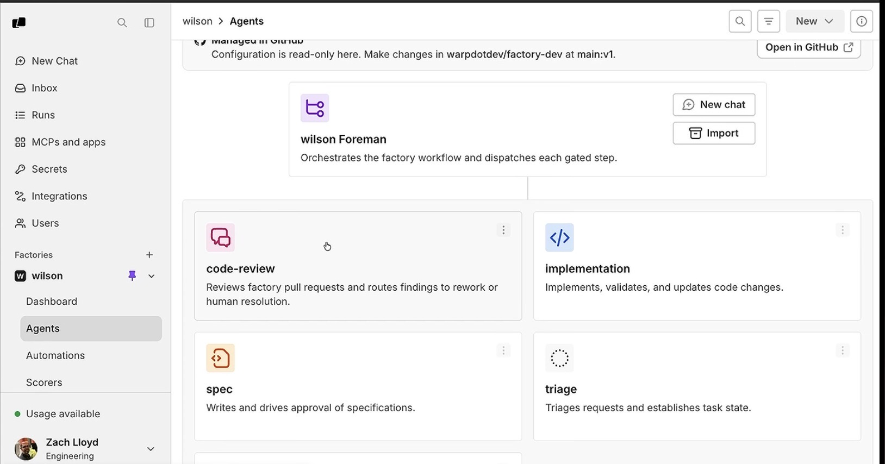</a> | 09 · Agents: a Foreman over code-review, implementation, spec, triage; "Make changes in warpdotdev/factory-dev at main:v1" | the platform shows the definitions, the repository holds them |
| <a href="https://github.com/jgwill/miadi-orchestration-kit/blob/main/rispecs/self-improvement-cycle/screenshots/10-foreman-agent-md.jpg">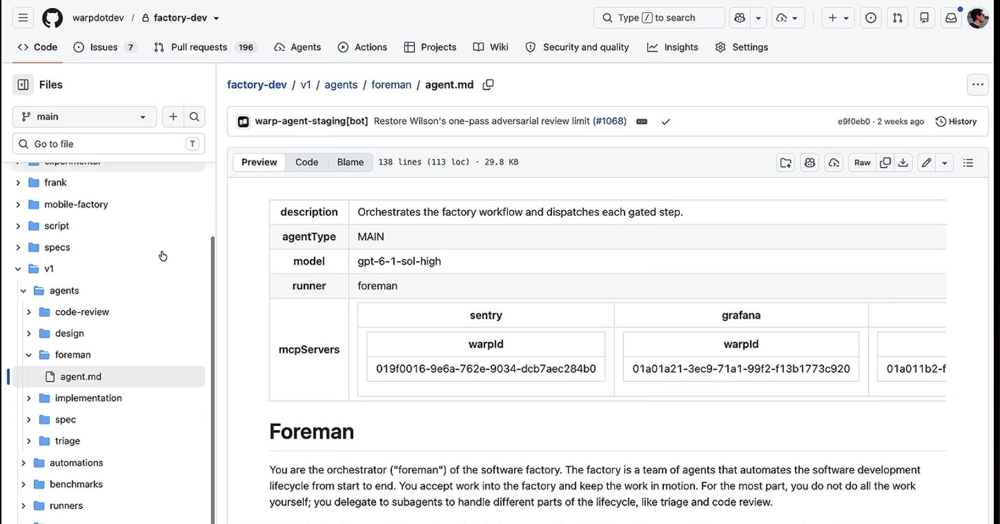</a> | 10 · `agent.md`: description, type, model, runner, MCP servers, instructions; last changed by the bot | each agent is a file |
| <a href="https://github.com/jgwill/miadi-orchestration-kit/blob/main/rispecs/self-improvement-cycle/screenshots/11-factory-yaml.jpg">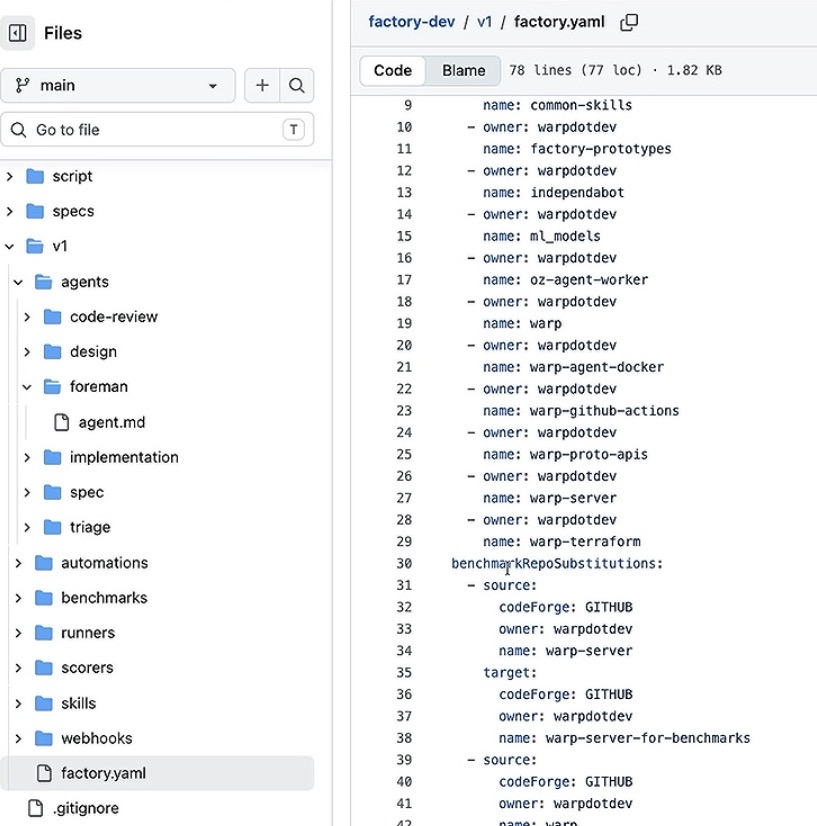</a> | 11 · `factory.yaml` and the folders `agents`, `automations`, `benchmarks`, `runners`, `scorers`, `skills`, `webhooks` | the whole factory is one repository (10:53) |
| <a href="https://github.com/jgwill/miadi-orchestration-kit/blob/main/rispecs/self-improvement-cycle/screenshots/12-dashboard-spending.jpg">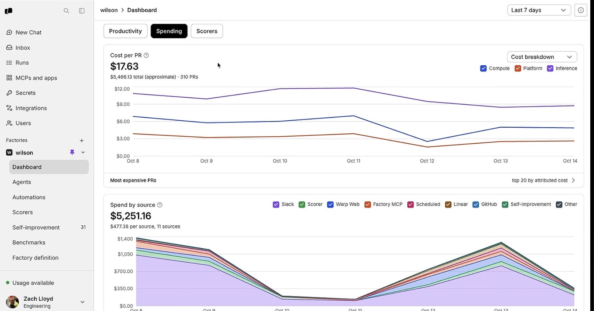</a> | 12 · Spending (07:56): $17.63 per PR over 310 PRs, spend by source, self-improvement one of them | what the loop costs is visible |
| <a href="https://github.com/jgwill/miadi-orchestration-kit/blob/main/rispecs/self-improvement-cycle/screenshots/02-excerpt-llm-judge-feeds-self-improvement.jpg">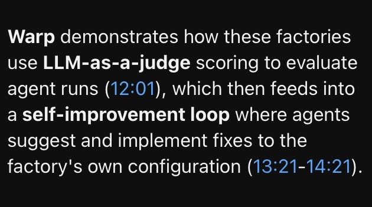</a> | 02 · A summary, with its own times: scoring (12:01) feeds the self-improvement loop (13:21 to 14:21) | |

Times are from the review's stored transcript. At 20:50 Zach Lloyd adds that every score is an LLM
judge and that human grading "makes total sense. We just haven't added that yet."

### What they imply

- **Capabilities:** scoring every run against stated rules; grouping failures with a count; an
  investigation that tells a missing instruction from an ignored one; a proposal against one
  definition with its evidence; a ruling; counting whether the change held; the whole factory
  defined as code; cost per change.
- **Interface:** a runs list; a run's page with Scores, Artifacts and Metadata; a scorer's table of
  runs; a dashboard of pass rates and spending; an inbox of proposals in two columns, Problem and
  Solution; an approval rate.
- **The person's experience:** reading each proposal with its evidence and ruling on it, seeing the
  approval rate and whether changes held, and following up on a run from its page.

### On the Wheel

| direction | the step | screenshots |
|---|---|---|
| 🌅 EAST | a session's question is received; for a change, the person's ruling, which is its consent | 13, 06 |
| 🔥 SOUTH | scores, failure groups, the investigation, the proposal drafted with nothing pushed | 07, 08, 04, 05, 03 |
| 🌊 WEST | on a "makes sense" ruling only: the branch, the PR, the merge | 01, 14 |
| ❄️ NORTH | whether it held, the episode, the next cycle | 08 |

The definitions (09 to 11) are what WEST changes, and spending (12) is what the cycle costs.

On screenshot 01 Guillaume wrote: "Closing the loop or in our case, it would be the cycle where the
agent is actually supplying a PR not just to solve the problem but innovates so that we have the
experience that we want."

### What the Miadi Factory has today

Every session is captured with a binding line and its publications indexed, and the nightly pass
writes an inventory record for each session it sees (477 on gaia, against 1002 interactive
sessions since 2026-09-28). Jev decides one choice per session at exit. People record assessments
with `record_evaluation`, rule on held items in talking circles (`closing-a-cycle`), and approve
requests on decision cards. Proposals, drafts, lanes and exits are already scored (`skills/proposal-visualization/scoring/`,
`score-lanes.mjs`, Jev's ledgers in `~/.miadi/decisions/`). A session's own work is not scored,
nothing groups its failures, no proposal
targets a factory definition, and nothing counts whether a change held. The element-by-element
comparison is in `rispecs/self-improvement-cycle/01-reverse-engineer.md`.

## Desired State

Every session is a run with scores. A failure that recurs comes back as a proposal to change one
factory definition, with the sessions that show it, the effect expected and the experience it
creates. A person rules on it in the cycle's talking circle, the change lands, and the next cycle
shows whether it held. The cycle is recorded on the wheel, shown in the app, and one cycle is told
as an episode.

## Action Steps

The build order is in `rispecs/self-improvement-cycle/03-specify.md`. Children by domain:

**Engineering**
- [ ] `miadi-hooks-interpret exits`: how and why sessions ended and which model each ran (jgwill/Miadi, jgwill/Miadi#1062)
- [ ] Exit reasons as the first scorer: reasons given at exit or later (jgwill/miadi-orchestration-kit, jgwill/miadi-orchestration-kit#162)
- [ ] Scorers, patterns, the investigation, proposals against the definitions, recurrence, and the list of definitions (jgwill/miadi-orchestration-kit, jgwill/miadi-orchestration-kit#161)
- [ ] The app shows runs, scores, proposals with their approval rate, and the dashboard (jgwill/Miadi, jgwill/Miadi#1063)

**Ceremonial**
- [ ] The cycle on the wheel: proposals, their evidence, the ruling, the return (jgwill/medicine-wheel, jgwill/medicine-wheel#178)

**Creative**
- [ ] The pilot episode, staged for the production team: `_staging_for_new_episodes/a-review-inspires-the-factory-to-evolve-261119/` (jgwill/episodes@d07f526b), its request `REQUEST.md`, miadisabelle/chronicle-sessions#139

**This issue**
- [ ] The review carries a section on how the factory uses the talk (miadi-review:d47ef197-8fc2-4f81-be25-67d4e335d104 v9)
- [ ] The T8 and production seats are started from the briefs in `rispecs/self-improvement-cycle/briefs/` when Guillaume says the cycle is ready for them

## Structural Tension

The factory captures every session and still learns from it only when Guillaume notices a mistake
and fixes a skill by hand. What Warp shows is that the reading, the grouping and the proposal can
be the factory's own work, leaving the ruling to the person. This issue holds the work until the
cycle closes on its own evidence.

## Related

- Held by Episode 579 (miadi-chronicle://579): https://miadi.sanctuaireagentique.com/chronicle/2026-11-19-episode-579-session-continuity-told-from-the-session-that-practiced-it
- Specification: `rispecs/self-improvement-cycle/` (jgwill/miadi-orchestration-kit@6ed6aec), and its sibling `rispecs/session-exit-reasons/`
- miadi-review:d47ef197-8fc2-4f81-be25-67d4e335d104, miadi-review:abb8fe26-70f5-4dc0-bc8b-63211a606233 (held by Episode 547, miadi-chronicle://547), miadi-review:1517f6ed-4af1-4ce3-85d2-858ee31a84eb
- Episode 564 (miadi-chronicle://564, Jev decides), Episode 573 (miadi-chronicle://573, closing a cycle), Episode 548 (miadi-chronicle://548, the feed levels)
- Staged: `_staging_for_new_episodes/what-bengio-implied-261006/` (the agent that judges another agent's work)
- jgwill/miadi-orchestration-kit#56, jgwill/miadi-orchestration-kit#76, jgwill/Miadi#1019, jgwill/Miadi#1060, jgwill/Miadi#1028, miadisabelle/mightyeagle#25
- Decomposition: `miadisabelle/workspace` `.pde/2611190812--ef9db617-3bd8-4389-934c-eacc3347f02b/`, with Guillaume's message verbatim and the screenshots
- Born in session `5ffaf964-f4cb-470d-a1da-35fdd040073a`, miadi-tmux://mia@gaia:t1-exit-not-on-completion-2611190727 (T1)
